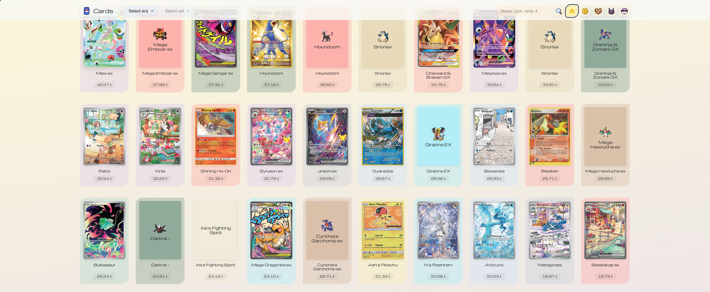

# inv

A Pokémon TCG card browser. Pick an era, pick a set, get the cards with current market prices
from [TCGdex](https://tcgdex.dev). Or browse by Pokémon, or by illustrator, and star cards to keep
them in a favorites list that follows you across devices once you sign in.

Live at [inv.siffert.io](https://inv.siffert.io).

<p align="center">
  
</p>

## About this project

This is an old weekend project. It started as an attempt at a mobile-first website and turned into a
card list somewhere along the way. It is not actively maintained and I do not care for it much — I
had an AI rework it so it is not quite as bad as it was. Expect rough edges.

## Running it

```
npm install
npm run fetch-data
npm run dev
```

The site does not call the TCGdex API from the browser. It reads a snapshot of all sets and
cards from `data/`, which `npm run fetch-data` downloads. Run it once before starting the dev server.

TCGdex needs no API key. Prices are only available per card, so a run requests every card of every
set individually and takes a while. Pokémon TCG Pocket sets are skipped, as they have no market
prices. The run also downloads a static sprite for every Pokémon that has cards into
`data/sprites/`.

Sign-in works out of the box against the Firebase project named in `.env`. For your own project,
see [Accounts](#accounts).

## Scripts

```
npm run dev         # dev server on :3030
npm run build       # typecheck, then production build into dist/
npm run start       # serve dist/ on 0.0.0.0:3030 (what the server runs)
npm run preview     # serve dist/ on localhost only
npm run fetch-data  # refresh the set and card snapshot in data/
npm run build-indexes  # rebuild pokemon, artist and search indexes from the card files, no network
npm run fetch-exclusives  # rebuild the Japanese exclusives set from scripts/exclusives/exclusives.json
npm run typecheck   # tsc for the app and for vite.config.ts
npm run lint        # eslint
npm run format      # prettier
```

A pre-commit hook runs the formatter and linter.

## Deploying

The server runs `npm start`, which serves the **built** output from `dist/`. Build before
restarting, or there will be nothing to serve:

```
git pull
npm install
npm run build
pm2 restart inv
```

`data/` lives outside `dist/`, so a rebuild keeps the snapshot. Refresh it daily with a pm2 cron job,
started once from the repository directory on the server:

```
pm2 start npm --name inv-fetch-data --cron-restart "0 4 * * *" --no-autorestart -- run fetch-data
pm2 save
```

pm2 runs the job once right away, then every day at 04:00. `--no-autorestart` stops pm2 from
restarting it after it exits, and `pm2 save` keeps it across reboots. Check a run with
`pm2 logs inv-fetch-data`, or trigger one by hand with `pm2 restart inv-fetch-data`.

Each file is written to a temporary path and renamed into place, so the site keeps serving the
previous data while a refresh runs, and a failed set keeps its previous file.

`.env` is tracked and holds the public Firebase config. Server-only overrides go into `.env.local`,
which git ignores and Vite loads on top.

`npm run dev` is for local work only. Do not run it as the public server: it ships unbundled source,
and its hot-reload WebSocket makes phones prompt for local network access.

## How it works

- **React + Vite + TypeScript**, SCSS modules for styling.
- **Snapshot** in `data/`: `sets.json` holds every set plus a `generatedAt` timestamp and
  `eurPerUsd`, the ECB reference rate fetched from Frankfurter during the run (the previous value is
  kept if that request fails). Price sorting uses it to compare TCGplayer prices with Cardmarket
  ones, falling back to a fixed rate when it is missing.
  `cards/<setId>.json` holds each set's cards sorted by trend price. `pokemon.json` and
  `artists.json` index the same cards by Pokémon and by illustrator, with per-entry card files
  under `pokemon/` and `artists/`. Each `pokemon.json` entry carries `evolvesFrom`, the Pokédex
  number of its pre-evolution, derived from the cards' "evolves from" names by majority vote. A small Vite plugin serves the directory under `/data` in both
  `dev` and `preview`, JSON with `Cache-Control: no-cache` and an ETag, images with a 30-day cache.
  `scripts/fetch-data.mjs` drives the download; the TCGdex client, the card mapping, the index
  writers and the file helpers live in `scripts/lib/`. `npm run build-indexes` reuses the index
  writers to regenerate `pokemon.json`, `artists.json`, `search.json` and the per-entry files from
  the card files already on disk, which is enough after a change to the index shape.
- **Japanese exclusives**: Japanese SV promos that never came out in English, either because their
  game text was never printed internationally or because every English print has a different
  illustrator. `scripts/scrape-exclusives.mjs` builds the candidate list from Limitless TCG once
  (cached in `data/limitless/`, `--refresh` scrapes again) and writes
  `scripts/exclusives/exclusives.json`, which is committed and corrected by hand. `fetch-data` and
  `npm run fetch-exclusives` turn that list into the set `svp-ja`: details from TCGdex `ja`, English
  names from Limitless, card images downloaded once from Limitless as PNG into
  `data/images/svp-ja/<number>/low.png` and `high.png`. Sets with PNG images carry
  `cardImageFormat: 'png'`, and those cards carry `language: 'ja'`.
- **TanStack Query** fetches the snapshot and persists it to IndexedDB so a revisit is instant.
  The set list is revalidated hourly; card queries are keyed by `generatedAt`, so a new snapshot
  drops the old cards. Only the eight most recently viewed card lists plus the sets behind your
  favorites are persisted, to keep the cache small; the search index is never persisted. The
  persisted cache carries a `buster` string in `main.tsx`. Bump it whenever the shape of
  `sets.json` or the card files changes, so browsers discard the old copy instead of running new
  code against old data.
- **Theming** is a `data-theme` attribute on `<html>`. The choice is stored in `localStorage` and
  falls back to the OS preference. An inline script in `index.html` applies it before first paint so
  the page does not flash the wrong theme.
- **Card grids** render every tile at once, but `content-visibility: auto` lets the browser skip
  layout and paint for tiles off screen, so a 300-card set costs about as much as the visible rows.
  Card images load lazily with their aspect ratio reserved up front. Cards without an image, or
  whose image fails to load after one retry, show a tinted placeholder with the card name.
- **Modes**: the toggle top left cycles Sets, Pokémon and Artists, and reads Favorites while you are
  there. Sets is the market view by era and set, Pokémon lists Pokémon by generation, Artists lists
  illustrators by card count, each with the illustrator's most expensive card as the
  tile. Each mode remembers its last page.
- **Search** filters the list you are on. The suggestions under the box also offer "all cards named …",
  which opens `/search?q=` with every matching card across every set, built from `data/search.json`,
  a compact index of name, set, image and trend price per card. Clicking a result opens the card in
  its set.
- **Links**: the selected set and the open card live in the URL (`/market?set=<setId>&card=<cardId>`),
  so the share buttons next to the selectors and the card title can copy them. Card details link to
  the card's set, its Pokémon and its illustrator.
- A dot next to a set name means that set is already stored offline.
- **Prices** come from TCGdex, which mirrors Cardmarket and TCGplayer price guides. Each card
  carries the timestamp of its last price update, shown under the price panels. When TCGdex maps
  several cards of a set to one Cardmarket product, only the lowest-numbered card keeps that
  product and price; the others get a Cardmarket search link and no price. A card without a
  Cardmarket price shows its TCGplayer market price instead, in USD and tagged as such. Those USD
  amounts take part in the price sort as they are, but not in the set and favorites totals, which
  stay in EUR. The daily refresh only picks up what TCGdex has re-synced, so prices can be older
  than the snapshot.
- **Variants**: the snapshot keeps which printings a card has (holo, reverse, 1st edition) and, where
  TCGdex names it, the holo pattern (cosmos, galaxy, cracked ice, rainbow, gold). Card details show
  them as chips, and the search box matches them, so "cosmos" finds the cosmos holos of a set.
- **Prices panel**: card details show one table, a row per printing (normal, reverse holo, and where
  TCGdex lists them, holo patterns, jumbo, stamped promos, 1st edition), a column per marketplace.
  Each cell is the trend or market price and links to that printing's product page. The bold row
  is the price the grid shows; the sort and the totals use it too. The set view sums those prices
  into a set value under the status line, next to the set's release month.
- **Sprites** are PokeAPI's 96×96 PNGs, scaled with `image-rendering: pixelated`.
- **Favorites** live in `localStorage` for guests. Signed-in users get them from Firestore instead.
  Firebase is loaded lazily, so guests never download it. The star next to a card name favorites the
  card; the small stars in the Prices table favorite one printing, which then shows on the favorites
  page with its own chip and price. Details below.

## Accounts

Sign-in is Google only, through Firebase Auth. It exists solely to sync favorites across devices.
No profile data is stored, the account id is the only thing that reaches the database.

The Firebase web config lives in `.env` as `VITE_FIREBASE_*` keys. Those values are public by
design; access is controlled by `firestore.rules`.

To set up a new Firebase project:

1. Create a project, add a Web app, and copy its config into `.env`.
2. Authentication → Sign-in method: enable Google. Authentication → Settings: add the site domain
   to the authorized domains.
3. Firestore: create a database (Standard edition, production mode).
4. Deploy the rules:

```
npx firebase login
npx firebase deploy --only firestore:rules
```

`.firebaserc` names the project and `firebase.json` points at the rules file.

### How favorites are stored

One document per user at `users/<uid>`, with a single field, `favorites`, a map keyed by card id:

```json
{
  "favorites": {
    "sv03-125": { "setId": "sv03", "addedAt": 1762436400000 },
    "xy8-61": { "setId": "xy8", "addedAt": 1762437000000 },
    "swsh4-25#Cracked Ice Holo": {
      "setId": "swsh4",
      "addedAt": 1762438000000,
      "cardId": "swsh4-25",
      "print": "Cracked Ice Holo"
    }
  }
}
```

`setId` tells the favorites page which card files to load, `addedAt` keeps the order. Keying by card
id makes every toggle a single-field write and rules out duplicates. A favorite for one specific
printing, starred from the Prices table, is keyed `cardId#print` and carries both fields, so it can
sit next to the plain card favorite. Entries without `print` are the card itself.

- **Writes**: starring is a `setDoc` with `merge: true` on that one key, unstarring is an `updateDoc`
  with `deleteField()`. Two devices changing different cards at the same time never overwrite each
  other, there is no read-modify-write.
- **Reads**: one `onSnapshot` listener on the document while signed in. Changes from any device
  arrive through it; your own writes show up before the server confirms them.
- **Offline**: Firestore's persistent cache is enabled and shared across tabs. The list renders from
  disk on revisit, toggles work without a connection and sync when it returns.
- **Rules**: a user may read, create, update and delete only `users/<their own uid>`, and only when
  the document holds exactly one key, `favorites`, holding a map. Everything else is denied.
- **Merge**: on the first sign-in on a device that already has guest favorites, a dialog offers to
  add them to the account. Confirming adds only the cards the account lacks and clears the device
  copy once Firestore has acknowledged the write. Dismissing leaves the device copy untouched and
  asks again next time.
- **Limits**: a document caps at 1 MiB, roughly 15k favorites per user at the current entry size.

Code: `src/util/ui/favorites/cloudFavorites.ts` holds the Firestore calls,
`FavoritesProvider.tsx` next to it switches between local and cloud and runs the merge,
`src/util/firebase/app.ts` initialises the SDK.

## Known gaps

- There is no test suite.
- Prices are whatever TCGdex reports and are not validated. See the price timestamp for their age.
- A card removed from the account can be offered again by the merge dialog on a device that still
  holds it as a guest favorite, since the device cannot tell "new here" from "deleted there".
